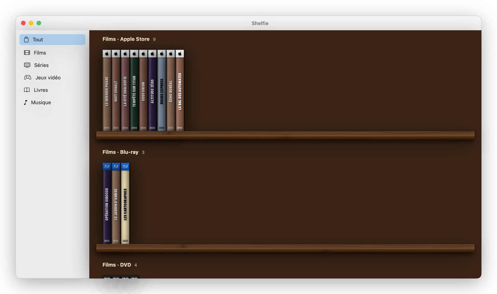

# Shelfie

> **Application universelle**\
> Mac à puce Apple et Mac Intel\
> macOS 13 ou plus récent

Vidéothèque et ludothèque personnelles pour Mac : films, séries, jeux vidéo, livres et musique, rangés sur de vraies étagères.

## Ce que fait Shelfie

- **Étagères** en bois ou en métal, jaquettes de face ou **tranches**, avec les logos des supports (DVD, Blu-ray, Apple TV, consoles…).
- **Défilé 3D** : les jaquettes défilent dans de vrais boîtiers en relief ; chaque série est un coffret qui s'ouvre sur ses saisons.
- **Fiches remplies toutes seules** : jaquette, année, résumé, réalisateur et acteurs, saisons et épisodes (TMDB, RAWG, Open Library, MusicBrainz, Wikipédia).
- **Import** depuis un fichier Excel ou CSV.
- **Liste d'envies** et **prêts** (à qui, depuis quand).
- **Sauvegardes automatiques**, et une bibliothèque qui peut être partagée entre deux Mac par iCloud Drive (avec Xbiblio aussi).
- **Mises à jour automatiques**.

## Installer

1. Téléchargez le fichier `Shelfie-….zip` de la [dernière version](https://github.com/Lkoubiac/Shelfie/releases/latest).
2. Ouvrez-le, puis glissez **Shelfie** dans le dossier **Applications**.
3. Au premier lancement, macOS peut refuser d'ouvrir une app téléchargée : faites un clic droit sur Shelfie › **Ouvrir**, puis confirmez.

## Mises à jour

Shelfie vérifie toute seule les nouvelles versions. Pour le faire tout de suite : menu **Shelfie › Rechercher les mises à jour…**

---

*Les images montrent une bibliothèque d'exemple inventée (titres et jaquettes imaginaires).*
