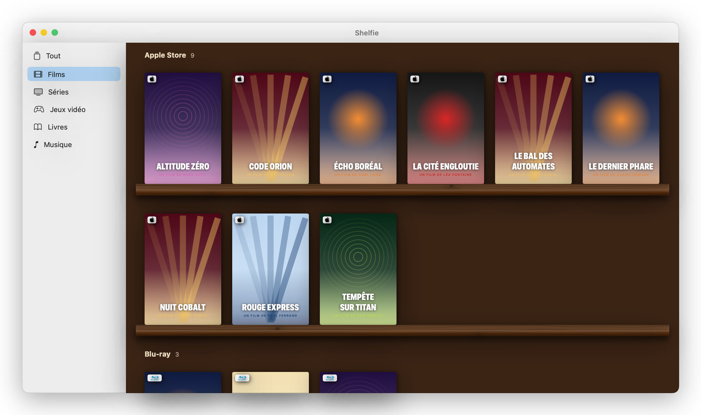
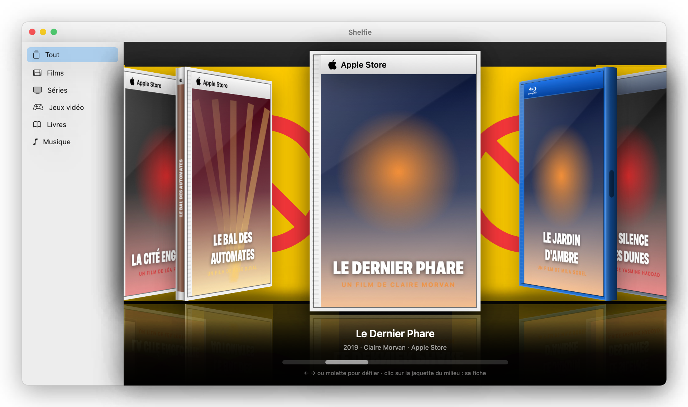
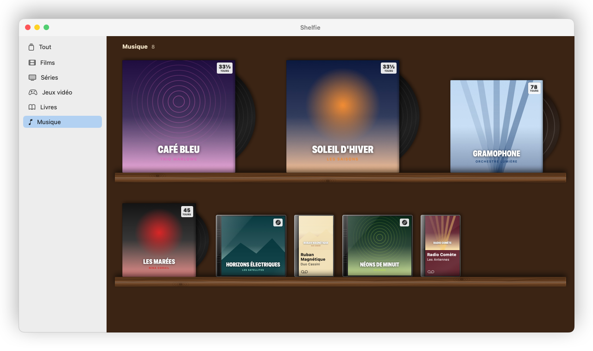

# Shelfie

> **Application universelle**\
> Mac à puce Apple et Mac Intel\
> macOS 13 ou plus récent

Vidéothèque et ludothèque personnelles pour Mac : films, séries, jeux vidéo, LEGO, livres et musique, rangés sur de vraies étagères.

## Ce que fait Shelfie

- **Étagères** en bois ou en métal, jaquettes de face ou **tranches** (chaque objet a la sienne : boîtier de DVD ou de jeu, dos de livre selon son format, côté de boîte LEGO, boîtier de CD, pochette de vinyle, cassette ; un boîtier sorti garde sa place, sa jaquette passe devant ses voisins comme dans une vraie bibliothèque). En haut de chaque jaquette, un **bandeau du support** (DVD, Blu-ray, Apple Store, numérique avec VO / VF), comme sur les vraies boîtes ; un titre possédé sur plusieurs supports montre le principal en bandeau et les autres en pastilles. Au choix dans les réglages : bandeau, petit logo ou rien.
- **Jeux vidéo** dans des boîtiers aux couleurs de leur console, avec le bandeau de la console, à la même taille que les films : 30 plateformes, de la PS1 à la PS5, de la première Xbox à la Xbox Series, de la NES à la Switch 2 (Wii, GameCube, Game Boy, DS, 3DS…), la Mega Drive, et les boutiques PS Store, Xbox Store, eShop, Steam, Epic Games et GOG. Vous cochez vos consoles dans les Réglages, et seules celles-ci sont proposées dans les fiches. Un jeu possédé sur plusieurs consoles a une seule jaquette, ou un boîtier par console si vous préférez (option).
- **LEGO** : de vraies boîtes en relief, plus grandes selon le nombre de pièces du set ; numéro, thème, pièces et figurines retrouvés tout seuls (Rebrickable).
- **Musique** : CD, vinyles 33, 45 et 78 tours, cassettes, chacun dessiné à sa taille (pochette carrée avec le disque qui dépasse, vitesse sur la pochette, boîtier de cassette transparent), avec une option « Tailles réelles » ; pochettes et **liste des titres** de chaque album trouvées sur Apple Music, et une recherche qui retrouve une chanson.
- **Livres** à la taille et à l'allure de leur format : poche, broché, relié, BD ; les livres numériques s'affichent dans une liseuse, sur l'étagère, en tranches et dans le Coverflow.
- **Coverflow** : les jaquettes défilent dans de vrais boîtiers en volume (DVD, Blu-ray, Apple Store, numérique, jeux, livres, boîtes LEGO, CD, vinyles, cassettes), en suivant le trackpad en douceur ; chaque série est un coffret qui s'ouvre sur ses saisons, avec la tranche de chaque saison côté ouverture.
- **Glisser une image** sur une jaquette (depuis le Finder, Aperçu ou une page web) pour la remplacer, avec un cadre pour l'ajuster ; sur un coffret, elle devient l'affiche de la série.
- **Trois tailles de jaquettes** d'un coup de curseur (Petite, Moyenne, Grande) : les jaquettes glissent vers leur nouvelle place en changeant de taille ; un réglage fin reste dans les Réglages.
- **Fiche dans une colonne** à droite de l'étagère, modifiable sur place (option).
- **Fiches remplies toutes seules** : jaquette, année, résumé, réalisateur et acteurs, saisons et épisodes (TMDB, IGDB, RAWG, Apple Books, Open Library, Google Books, Apple Music, MusicBrainz, Wikipédia, Rebrickable). Livres : les éditions françaises d'Apple Books, et un format « BD ».
- **Jaquettes proposées** : en ajoutant un livre, un jeu ou un album, plusieurs jaquettes sont proposées, un clic en prend une autre ; « Plus de choix… » ouvre une grande grille (IGDB, RAWG et SteamGridDB pour les jeux).
- **Clés des services** rangées par rubrique dans les Réglages, chacune avec son rôle (nécessaire, conseillée, facultative) et son état, et un bouton « Tout tester ».
- **Options par rubrique** : résumés, acteurs, sagas, saisons manquantes, épisodes, VO / VF (films et séries en numérique)…
- **Import** depuis un fichier Excel ou CSV (un onglet par rubrique).
- **Liste d'envies** et **prêts** (à qui, depuis quand).
- **Impression et PDF** soignés : en-tête par rubrique, groupes aux couleurs des supports, jaquettes ou liste avec vignettes (et case à cocher pour un inventaire).
- **Votre collection sur l'iPhone** : une page à garder dans iCloud Drive, consultable sans connexion ; jaquettes en grille ou en liste, fiche détaillée au toucher, et une recherche qui répond tout de suite « Déjà chez vous » ou « Pas dans votre collection » (pratique en magasin).
- **Sauvegardes automatiques**, et une bibliothèque qui peut être partagée entre deux Mac par iCloud Drive (avec Xbiblio aussi).
- **Mises à jour automatiques**.

## Installer

1. Téléchargez le fichier `Shelfie-….zip` de la [dernière version](https://github.com/Lkoubiac/Shelfie/releases/latest).
2. Ouvrez-le, puis glissez **Shelfie** dans le dossier **Applications**.
3. Au premier lancement, macOS peut refuser d'ouvrir une app téléchargée : faites un clic droit sur Shelfie › **Ouvrir**, puis confirmez.

## Mises à jour

Shelfie vérifie toute seule les nouvelles versions. Pour le faire tout de suite : menu **Shelfie › Rechercher les mises à jour…**

---

*Les images montrent une bibliothèque d'exemple inventée (titres et jaquettes imaginaires).*
